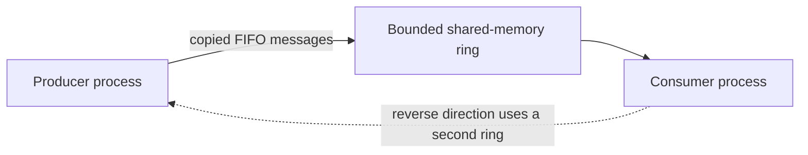

# Shared-memory ring lab

A small C++17 project for sending bounded messages between two independent processes. Build it, start a consumer, then feed lines to a producer. Each message is copied through a FIFO shared-memory ring. Duplex communication uses two rings, one per direction.

The first milestone is deliberately SPSC: one writer process and one reader process per ring. It uses operating-system synchronization for correctness; it is not lock-free or zero-copy.

## Build and test

### Linux and macOS

```sh
cmake -S . -B build -DCMAKE_BUILD_TYPE=Release
cmake --build build --parallel
ctest --test-dir build --output-on-failure
```

### Linux proof in Docker

With Docker Engine or Docker Desktop already running:

```sh
bash scripts/docker-linux-proof.sh
```

The script builds a Debian Bookworm image, builds the project inside it, runs all eight CTest scenarios three times, then starts a host, producer, and consumer as separate processes. The process proof sends 5,000 ordered frames, checks the received count and full byte stream, and prints the SHA-256 digest. The container reports its actual OS, architecture, compiler, and CMake versions. It does not change Docker daemon networking or security settings.

### Windows (Visual Studio 2022 / MSVC)

The CMake preset requires CMake 3.21 or newer:

```bat
cmake --preset windows-msvc-x64
cmake --build --preset windows-msvc-x64-release --parallel
ctest --preset windows-msvc-x64-release
```

The full native PB-MSI checklist is in [`docs/windows-proof-checklist.md`](docs/windows-proof-checklist.md).

## Try one producer and one consumer

The `host` command creates a session and keeps its handles open until you press Enter. That matters on Windows, where named mappings and mutexes disappear when the last process closes its handles. On POSIX, it also gives the example one simple lifetime to follow.

### Linux and macOS

From the project directory, prepare three lines:

```sh
mkdir -p showcase-data
printf 'oak\npine\nmaple\n' > showcase-data/input.txt
```

Open three terminals in the project directory.

**Terminal A — create and hold the session:**

```sh
build/shm_ring_demo host showcase 4 256
```

**Terminal B — start the consumer:**

```sh
build/shm_ring_demo consume showcase > showcase-data/received.txt
```

**Terminal C — send the three lines:**

```sh
build/shm_ring_demo produce showcase < showcase-data/input.txt
```

After the producer and consumer exit, check the message count and exact contents:

```sh
set -e
test "$(wc -l < showcase-data/received.txt | tr -d '[:space:]')" = 3
cmp showcase-data/input.txt showcase-data/received.txt
echo "PASS: 3 messages match byte-for-byte"
```

Then press Enter in Terminal A. Once all peers have exited, remove the session:

```sh
build/shm_ring_demo cleanup showcase
```

### Windows (Command Prompt)

Prepare the same input in the project directory:

```bat
if not exist showcase-data mkdir showcase-data
(echo oak& echo pine& echo maple) > showcase-data\input.txt
```

Open three Command Prompt windows in the project directory.

**Terminal A — create and hold the session:**

```bat
build\windows-msvc-x64\Release\shm_ring_demo.exe host showcase 4 256
```

**Terminal B — start the consumer:**

```bat
build\windows-msvc-x64\Release\shm_ring_demo.exe consume showcase > showcase-data\received.txt
```

**Terminal C — send the three lines:**

```bat
type showcase-data\input.txt | build\windows-msvc-x64\Release\shm_ring_demo.exe produce showcase
```

After both peers exit, compare the files and verify the count:

```bat
fc /b showcase-data\input.txt showcase-data\received.txt && powershell -NoProfile -Command "$inputPath='showcase-data\input.txt'; $outputPath='showcase-data\received.txt'; $count=@(Get-Content -LiteralPath $outputPath).Count; $inputHash=(Get-FileHash -Algorithm SHA256 -LiteralPath $inputPath).Hash; $outputHash=(Get-FileHash -Algorithm SHA256 -LiteralPath $outputPath).Hash; if($count -ne 3 -or $inputHash -ne $outputHash){ Write-Error 'count or SHA256 mismatch'; exit 1 }; Write-Output ('PASS messages=' + $count + ' SHA256=' + $inputHash)"
```

Press Enter in Terminal A after the peers have exited, then run:

```bat
build\windows-msvc-x64\Release\shm_ring_demo.exe cleanup showcase
```

## Platform status

| Platform | Backend in the project | Verification status |
| --- | --- | --- |
| macOS | POSIX shared memory and named semaphore | On 2026-10-11, a native build and all 8 process-level correctness scenarios passed on macOS 26.6.2 arm64 with Apple Clang 21.0.0; the suite passed 3 consecutive runs. |
| Linux | POSIX shared memory and named semaphore | Docker build/test scaffold is present; Linux has not been run because the Docker CLI cannot reach its daemon on this host. |
| Windows | Win32 file mapping and named mutex | MSVC x64 preset and PB-MSI checklist are present; a native build and tests have not yet run. |

Treat Windows and Linux as intended targets until their native verification phases in [the backlog](docs/verification-backlog.md) are complete. The current macOS result does not prove either target.

## How it works



The application API is in [`include/shm_ring_lab/session.hpp`](include/shm_ring_lab/session.hpp); the operating-system boundary is in [`src/platform/`](src/platform/). No C++ mutex or atomic is assumed to work between processes. Shared data contains fixed-width fields and bytes, never process-local pointers or handles.

Messages are limited to 1 MiB each and rings to 4096 slots (the mapping is capped at 64 MiB). Writes and reads copy complete messages while holding the OS lock. Full and empty rings wait only until the caller's deadline. `close_writer()` lets the consumer drain queued messages before it observes end-of-stream.

Sessions are transient, not durable. A crashed process does not trigger frame recovery. POSIX named semaphores cannot recover a lock permit abandoned by a dead process; Windows reports an abandoned mutex and this implementation fails the session. Discard that session and use a fresh name. On POSIX, call `cleanup` only after every peer has exited and can no longer open the name; unlinking earlier can split peers across two objects. See the [V1 protocol notes](docs/protocol-v1.md) for the full contract.

Build files and showcase output are ignored by Git. The benchmark helper is non-gating and has not been run; no throughput claims are made.
