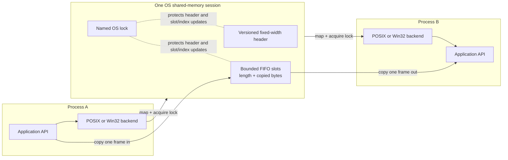

# Architecture

For duplex communication, create a second session with its own ring and lock in the reverse direction. The public C++ API does not expose OS mapping handles. POSIX and Windows naming, mapping, locking, cleanup, and process-ID calls are isolated under `src/platform/`.
